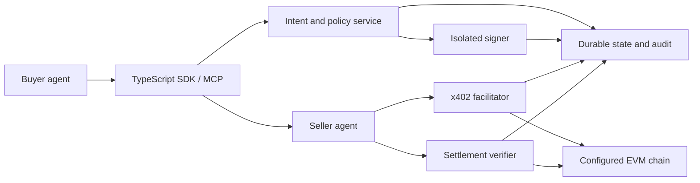

# Architecture

Status: proposed implementation baseline, 2026-11-01. Production readiness is not claimed.

## Boundaries

MCP is an interaction boundary, not a custody or authorization boundary. The model may request a payment under an operator-created policy; it cannot approve its own budget, access wallet keys, select arbitrary RPCs, replace policies, or call raw signing methods. A separate signer process accepts narrow validated intents via an authenticated local transport. Same-user process separation is useful but does not resist a compromised host; production requires a separate OS identity/container or external signer/KMS/HSM.

## Trust and persistence

Persist immutable payment intent fields: agent/principal ID, quote ID, idempotency key, request hash, normalized service origin/resource, chain ID, asset, decimals, payee, atomic amount, expiry, policy revision and approval ID. Store amounts as base-10 strings/bigints, never floating point. URL redirects, arbitrary hosts, metadata URLs, and unbounded bodies are rejected.

Enforce budgets on the signer side. Reserve worst-case payment and gas atomically before signing; in-flight authorizations count as spend until settled, revoked or safely expired. Use durable unique constraints for quote and authorization consumption. Serialize transaction nonces per sender. On failures preserve reservations when submission outcome is unknown.

Payment states: QUOTED → POLICY_APPROVED → RESERVED → AUTHORIZED → SUBMITTED → INCLUDED → FINALIZED → DELIVERED. DENIED and proven EXPIRED/REVERTED are terminal alternatives. Unknown submission is RECONCILING, never automatically FAILED/RETRY_WITH_NEW_PAYMENT. Persist enough information before broadcasting to recover the same signed transaction/hash; never log raw signing payloads or keys. Replay delivers an existing result only to the authenticated same buyer and intent.

Seller-side idempotency joins the exact request digest and quote with an authorization hash/nonce and authenticated payer. A signed transfer binds token/amount/payee/chain; it does not universally bind arbitrary HTTP bodies, so this application binding must be enforced. A bearer proof must not be redeemable for a second task. The test proves one service result per payment, not fairness against a malicious seller.

## Chain and token capability registry

Use CAIP-2 IDs (`eip155:943`) with explicit, operator-controlled chain profiles. Verify RPC chain ID at startup and before public signing. Profiles contain finality policy, fee strategy, allowed RPC origins, assets and code hashes, optional x402/identity/smart-account capability records and evidence date. Unknown means disabled. Do not infer an asset from a symbol or convert dollar strings without an approved asset.

Mainnet profile is read-only in M1. Local profile must require an owned loopback ephemeral node; chain ID 31337 alone is not authorization. Chain fork simulations never broadcast to the upstream. No network auto-fallback across chain IDs.

ERC-20 support is not EIP-3009 support. Permit2 requires bounded prior token allowance plus verified Permit2/proxy deployments. EIP-3009 requires verified domain, authorization semantics and nonce handling. Bridged/forked token provenance and redeemability are separate from ABI compatibility. Fee-on-transfer, rebasing and unknown proxy-upgrade behavior are unsupported until specifically tested.

## Audit

Append-only structured events with schema version, sequence, UTC timestamp, previous-event hash, event hash, intent ID, actor, policy/approval reference and redacted payload. Record rejections and recovery decisions as well as success. Persist before side effects; fail closed if durable writes fail. Exclude secrets, environment dumps, reusable raw authorizations and unbounded upstream exceptions.

Hash chaining detects edits relative to a trusted terminal hash. It does not prevent a writer rewriting the whole file or truncating an unanchored tail. M1 exports a manifest with terminal hash, expected terminal state, tx receipt, canonical/finality evidence and result digest. Independent signing/anchoring and WORM retention are later production controls.

## Interfaces and later stages

SDK operations: discover configured services, request quote, request payment under policy, get intent status, verify settlement, read redacted audit. MCP exposes these same bounded operations; operator approval and credential loading remain outside MCP. Developer API can wrap the SDK after auth/rate limits are specified.

ERC-8004: use upstream registration shape and registry ABI; per-chain read adapters can be added after checking deployed bytecode/proxy implementation/version. Identity registration is neither service authorization nor proof of reputation. Handle untrusted metadata with SSRF limits. No fabricated registry address.

ERC-4337: use existing account-abstraction interfaces and maintained account clients only after identifying verified EntryPoint version, account factory, bundler RPC, supportedEntryPoints, gas estimates, paymaster policy if used, and a successful test UserOperation. A normal Ethereum RPC is not a bundler. Do not require 4337 for M1.

Escrow: separate future milestone after direct settlement. Define task commitment, payer/payee, token, deadlines, release authority, cancellation, refund and disputes before choosing audited contracts. Require adversarial contract tests, independent review and bounded testnet deployment. x402 payment itself does not supply escrow or service-quality guarantees.

Multi-chain: reuse EVM adapters and capability profiles, keeping verification/nonce/budget state partitioned by chain. No bridge or cross-chain atomicity claim.
